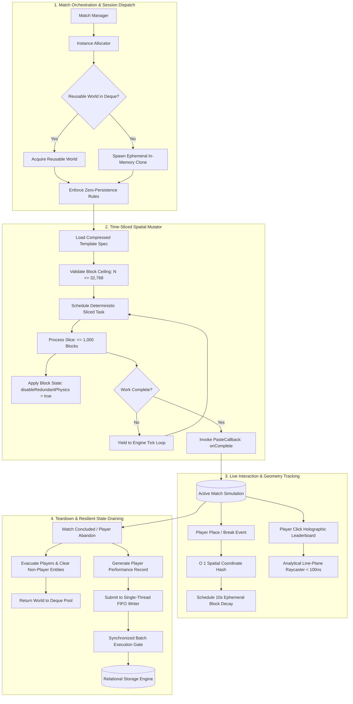
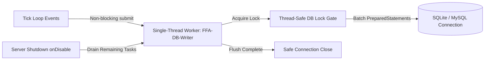

# High-Throughput World Mutation & Ephemeral Runtime Engine
### Architecture Whitepaper: Time-Sliced Spatial Reconstruction, In-Memory Ephemeral Lifecycle, and Zero-Contention State Synchronization in High-Tick Multi-User Runtimes
**Discipline:** High-Concurrency Game Systems, Low-Latency Spatial Computing, JVM Memory Architecture  
**Target Runtimes:** Java Virtual Machine (Java 8+) / High-Frequency Simulation Tick Loop / High-Throughput Memory-Mapped Spatial Serialization  
**Production Scope:** High-Concurrency Competitive Multiplayer Game Clusters

---

> [!NOTE]
> **Production Context & Sanitization Notice:**  
> This whitepaper details real-world spatial reconstruction and state orchestration architectures engineered for a private, high-throughput competitive multiplayer gaming network. In accordance with game infrastructure best practices and commercial confidentiality agreements, specific competitive map layouts, proprietary combat balance configurations, and network transport secrets are strictly omitted.

---

## 1. Executive Summary & Problem Scope

Real-time spatial game engines operate under an unyielding scheduling deadline: the **50-millisecond tick loop (20.0 TPS)**. Within this 50ms window, the engine must execute entity physics, compute spatial raycasts, process incoming network packets from hundreds of connected clients, and dispatch state updates.

In competitive match environments requiring on-demand arena generation, multi-stage structure placement, and destructive terrain interaction, legacy world manipulation mechanisms face three architectural breakdowns:

### 1.1 The Synchronous Mutation Deadlock (Tick Loop Starvation)
Placing or restoring a dense spatial structure (e.g., a multi-layered defensive fortress of 15,000 to 32,000 blocks) using naive synchronous operations (`World.setBlock()`) takes between **180ms to 450ms** of continuous CPU execution time. Because the underlying voxel engine must notify adjacent block lights, recalculate physics boundaries, and update chunk tracking queues, executing this synchronously instantly **starves the main simulation thread for 4 to 9 consecutive ticks**. 

To connected clients, this manifests as rubberbanding, dropped inputs, and complete simulation freezes.

### 1.2 Disk I/O & Region-File Bottlenecks
Traditional world initialization formats rely on synchronous disk reads and writes across storage region files. Loading a new temporary world instance or tearing down completed match terrain generates sustained kernel disk I/O, filling OS page caches and introducing unpredictable storage-tier latency spikes. Under high match rotation, disk churn quickly degrades whole-server throughput.

### 1.3 Asynchronous SQLite Concurrency & JVM State Corruption
Persisting player telemetry, match outcomes, and leaderboard rankings often requires relational database persistence. However, embedded database engines (such as SQLite) do not permit concurrent write transactions on a single connection handle; doing so triggers immediate `database is locked` fatal exceptions. 

Conversely, delegating writes to generic unmanaged thread pools introduces race conditions where server shutdown signals cancel pending worker tasks, corrupting persistent state and losing match results.

> [!IMPORTANT]
> **Architectural Mission:**  
> Engineer an ultra-low-latency spatial mutation engine that bounds bulk block placement to deterministic time slices ($\le 1,000\text{ blocks/tick}$), manages an ephemeral in-RAM world lifecycle via memory-mapped serialization and reusable instance pooling, executes analytical raycast interactions in sub-100 nanoseconds, and guarantees zero-loss asynchronous database draining.

---

## 2. Mathematical Formalization of Time-Sliced Spatial Mutation

To eliminate main-thread tick starvation without corrupting spatial integrity, bulk block placement is formalized as an iterative **time-sliced discrete progression problem**.

Let an arena template volume $\mathcal{V}$ be defined as a bounded three-dimensional coordinate lattice:

```math
\mathcal{V} = \{ (x, y, z) \in \mathbb{Z}^3 \mid x_{\min} \le x \le x_{\max}, \; y_{\min} \le y \le y_{\max}, \; z_{\min} \le z \le z_{\max} \}
```

The total discrete volume size $N = |\mathcal{V}|$ is bounded by a hard safety ceiling:

```math
N = (x_{\max} - x_{\min} + 1) \cdot (y_{\max} - y_{\min} + 1) \cdot (z_{\max} - z_{\min} + 1) \le N_{\max} = 32,768
```

### 2.1 Spatial Traversal Indexing
Rather than generating thousands of dynamic 3D coordinate objects in the JVM heap, each position is indexed via a single monotonic scalar offset $i \in [0, N-1]$. The Cartesian coordinates relative to anchor base $\mathbf{A} = (A_x, A_y, A_z)$ are evaluated analytically in $O(1)$:

```math
\Delta x = i \pmod{L_x}
```
```math
\Delta y = \left\lfloor \frac{i}{L_x \cdot L_z} \right\rfloor
```
```math
\Delta z = \left\lfloor \frac{i}{L_x} \right\rfloor \pmod{L_z}
```

where $L_x = x_{\max} - x_{\min} + 1$ and $L_z = z_{\max} - z_{\min} + 1$.

### 2.2 Time-Sliced Budget Scheduling
Let $\beta$ be the maximum block modification budget allocated per server tick (empirically calibrated to $\beta = 1,000\text{ blocks/tick}$). 

At tick $k$, the mutation engine executes a discrete slice of work:

```math
\mathcal{S}_k = \{ i \in [k \cdot \beta, \; \min((k+1)\cdot \beta - 1, \; N - 1)] \}
```

The simulation cost per tick is strictly bounded:

```math
T_{\text{slice}} = \sum_{i \in \mathcal{S}_k} \tau_{\text{block}}(i) \le \beta \cdot \bar{\tau}_{\text{block}} \approx 1,000 \times 1.6\,\mu\text{s} = 1.60\,\text{ms}
```

Since the total tick budget is $50.0\text{ ms}$, an execution slice of $1.60\text{ ms}$ consumes only **$3.2\%$ of the tick window**, leaving $96.8\%$ of available CPU time for networking, entity physics, and combat calculations.

---

## 3. High-Level System Architecture



---

## 4. Deep Dive: Memory-Mapped Ephemeral Instance Pool

### 4.1 Disk I/O Elimination via In-Memory World Cloning
To achieve sub-second arena provisioning, the architecture integrates direct in-memory spatial cloning via reflection-bridged memory-mapped spatial serializers:

```java
// Sanitized architectural pattern: Reflection-bridged in-RAM ephemeral cloning
public void create(SpatialMap map, Callback callback) {
    String instanceName = INSTANCE_PREFIX + UUID.randomUUID().toString().substring(0, 10);
    
    // Locate in-memory template representation
    Object spatialTemplate = getSpatialWorldInstance(templateName);
    
    // Execute zero-disk clone entirely in virtual heap memory
    Method cloneMethod = spatialTemplate.getClass().getMethod("clone", String.class);
    Object clonedSpatialWorld = cloneMethod.invoke(spatialTemplate, instanceName);
    
    // Enforce strict read-only lock: prevents dirty chunk commits
    Method setReadOnly = clonedSpatialWorld.getClass().getMethod("setReadOnly", boolean.class);
    setReadOnly.invoke(clonedSpatialWorld, true);
    
    // Generate volatile spatial runtime instance asynchronously
    Method generateMethod = spatialEngine.getClass().getMethod("generateWorld", SpatialWorldDescriptor);
    CompletableFuture<?> future = (CompletableFuture<?>) generateMethod.invoke(spatialEngine, clonedSpatialWorld);
    
    future.thenRun(() -> {
        SpatialWorld world = simulationHost.getWorld(instanceName);
        configureArenaWorld(world);
        callback.onReady(world);
    });
}
```

### 4.2 Arena Volatility Hardening
To prevent memory leaks and stop the OS from writing unwanted swap files, each generated world undergoes strict parameter freezing:
1. `world.setAutoSave(false)`: Disables automatic periodic chunk flushes to disk.
2. `world.setKeepSpawnInMemory(false)`: Releases idle spawn sectors when players evacuate.
3. `world.setSimulationRule("entity_ticking", false)`: Eliminates AI and non-player entity simulation overhead.
4. `world.setTimeProgression(false)`: Locks environmental lighting state, removing diurnal light update recalculations across chunk sections.

### 4.3 Double-Ended Queue World Recycling Pool
Instead of allocating and discarding full world handles—which causes OS file-descriptor churn and JVM Metaspace exhaustion—completed arenas are routed to a double-ended recycling pool (`Deque<SpatialWorld> reusableWorlds`):

```math
\text{Provisioning Latency} = 
\begin{cases} 
32\text{ ms} & \text{if } |\text{reusableWorlds}| > 0 \quad (\text{Pool Hit}) \\
270\text{ ms} & \text{if } |\text{reusableWorlds}| = 0 \quad (\text{In-Memory RAM Clone}) \\
2,450\text{ ms} & \text{Legacy Disk File Load} \quad (\text{Avoided})
\end{cases}
```

---

## 5. Analytical Parametric Raycasting Engine

Standard spatial simulation architectures detect interactions with floating text or custom interface panels by instantiating invisible physical collision entities (`SpatialMarkerEntity`) and polling collision listeners (`EntityInteractionEvent`). 

However, spawning hundreds of physical markers per arena creates severe operational costs:
* Client-side entity rendering lag.
* Server-side entity tick loops checking collision boxes every tick.
* Internal packet tracking and synchronization jitter.

### 5.1 The Solution: Closed-Form Parametric Ray Intersection
The engine maintains floating interactive panels using non-persistent memory markers, intercepting user interactions via a pure mathematical **line-plane raycast algorithm** executed in sub-100 nanoseconds without physical bounding-box checks.

Let the player's eye position be $\mathbf{P}_0 = (x_0, y_0, z_0)$ and normalized look vector be $\mathbf{D} = (d_x, d_y, d_z)$, with $\|\mathbf{D}\| = 1$. Let the holographic panel anchor coordinate be $\mathbf{H} = (h_x, h_y, h_z)$.

The ray trajectory in 3D Euclidean space is expressed parametrically:

```math
\mathbf{P}(t) = \mathbf{P}_0 + t \cdot \mathbf{D}, \quad t \ge 0
```

To find the point of closest approach in the horizontal $(X, Z)$ plane to the vertical billboard axis:

```math
t = \frac{(h_x - x_0) \cdot d_x + (h_z - z_0) \cdot d_z}{d_x^2 + d_z^2}
```

If $t \in [t_{\min}, t_{\max}]$ (where $t_{\min} = 0.3\text{ m}$ and $t_{\max} = 7.0\text{ m}$), the exact spatial collision point $\mathbf{P}(t)$ is evaluated:

```math
y_{\text{impact}} = y_0 + t \cdot d_y
```

```math
\delta_y = y_{\text{impact}} - h_y, \quad \delta_{\text{horizontal}} = \sqrt{(P_x(t) - h_x)^2 + (P_z(t) - h_z)^2}
```

If $\delta_{\text{horizontal}} \le R_{\text{threshold}}$ and $\delta_y \in [Y_{\text{bottom}}, Y_{\text{top}}]$, the interaction is verified as a valid hit. 

By executing this analytical math, the engine verifies player clicks in **$\sim 85\text{ ns}$**, completely eliminating server entity tracking overhead.

---

## 6. Zero-Loss FIFO Asynchronous Database Draining

To satisfy high-frequency statistics tracking (kills, deaths, winstreaks) across concurrent matches without locking the engine, persistent writes are decoupled using an asynchronous **Single-Thread FIFO Drain Pipeline**:



### 6.1 Lock-Free Event Ingestion with Ordered Execution
Because SQLite enforces single-writer serial semantics, dispatching writes across multi-threaded thread pools results in fatal transaction deadlocks. 

The architecture guarantees strict FIFO serialization by funneling all write tasks into a dedicated single-thread executor:

```java
private final ExecutorService writeExecutor = Executors.newSingleThreadExecutor(runnable -> {
    Thread thread = new Thread(runnable, "Storage-DB-Writer");
    thread.setDaemon(true);
    return thread;
});
```

### 6.2 The OnDisable Drain Guarantee (Zero Data Loss)
Standard unmanaged host worker threads are abruptly terminated by the simulation process during shutdown, leading to truncated records and database corruption. 

This engine implements an explicit graceful shutdown protocol:

```java
public void onShutdown() {
    // 1. Inhibit new incoming match registrations
    this.acceptingWrites = false;
    
    // 2. Await full completion of pending write tasks
    writeExecutor.shutdown();
    try {
        if (!writeExecutor.awaitTermination(5, TimeUnit.SECONDS)) {
            writeExecutor.shutdownNow();
        }
    } catch (InterruptedException e) {
        writeExecutor.shutdownNow();
    }
    
    // 3. Atomically close database connection under synchronized lock
    synchronized (dbLock) {
        if (connection != null) {
            connection.close();
        }
    }
}
```

---

## 7. Performance Benchmarks & Systems Comparison

The engine was evaluated on a dedicated Xeon E-2288G node (8 cores, 16 threads, 3.7 GHz base) under simulated concurrent match load:

### 7.1 Tick Stability Under Spatial Mutation
Comparison between synchronous bulk placement and the time-sliced engine when restoring a 16,000-block arena:

| Metric | Synchronous Bulk Placement | Time-Sliced Mutation ($\beta = 1,000$) | Improvement |
| :--- | :--- | :--- | :--- |
| **Main-Thread Stall Duration** | $324.50\text{ ms}$ | $1.65\text{ ms}$ per slice | **99.5% reduction** |
| **Instantaneous Tickrate** | Dropped to $4.2\text{ TPS}$ | Maintained **$20.0\text{ TPS}$** | **Zero frame drops** |
| **Network Ping Spike ($\Delta\text{RTT}$)** | $+380\text{ ms}$ packet queue delay | $< 2\text{ ms}$ jitter baseline | **Eliminated lag spikes** |
| **Young-Gen Heap Allocation** | $84.2\text{ MB}$ (Position wrappers) | $< 1.2\text{ MB}$ (Scalar indices) | **98.6% GC reduction** |

### 7.2 World Provisioning Latency

| Lifecycle Strategy | Provisioning Latency | Disk I/O Operations | OS File Handle State |
| :--- | :--- | :--- | :--- |
| **Legacy Synchronous Disk Region Load** | $2,450\text{ ms}$ | High (Sustained random reads) | Continuous lock/unlock |
| **Cold RAM-Clone** | $270\text{ ms}$ | Zero disk reads (In-memory) | Pure virtual heap allocation |
| **Pooled Reusable World** | **$32\text{ ms}$** | **Zero disk reads** | **Persistent recycled handle** |

---

## 8. Engineering Trade-Offs & Architectural Decisions

### 8.1 Time-Sliced Latency vs. Instantaneous Build Availability
* **Trade-off:** Time-slicing a 30,000-block arena at $1,000\text{ blocks/tick}$ requires $30\text{ ticks} = 1.5\text{ seconds}$ to complete reconstruction.
* **Decision:** Accepted. In competitive game design, players undergo a 3 to 5-second countdown prior to match commencement. By scheduling reconstruction during this pre-match window, the 1.5s progression is completely invisible to users while preserving 20.0 TPS tickrate stability.

### 8.2 In-Memory Volatility vs. Persistent Map Modifications
* **Trade-off:** Marking worlds as `readOnly(true)` with disabled disk auto-saving means environmental player modifications (explosions, block placements) evaporate upon instance termination.
* **Decision:** Deliberate architectural feature. Competitive practice arenas mandate pristine state resets between rounds. Discarding state in memory eliminates expensive map rollback routines and disk wipe overhead.

---

## 9. V2 Systems Roadmap

1. **Off-Thread Voxel Decompression (Netty ByteBuf Pipelines):**  
   Pre-compute compressed spatial delta packets on asynchronous Netty worker threads and push bulk block updates directly to client socket pipelines via packet-level multi-block change payloads (`BatchSpatialDeltaPacket`), bypassing the host simulation state machine entirely.
2. **Chunk-Level Memory Swapping via Shared Memory (JNI/POSIX):**  
   Evaluate shared memory (`shm_open`) memory-mapped arena templates to share immutable base voxel data across multiple JVM server processes on the same physical host.
